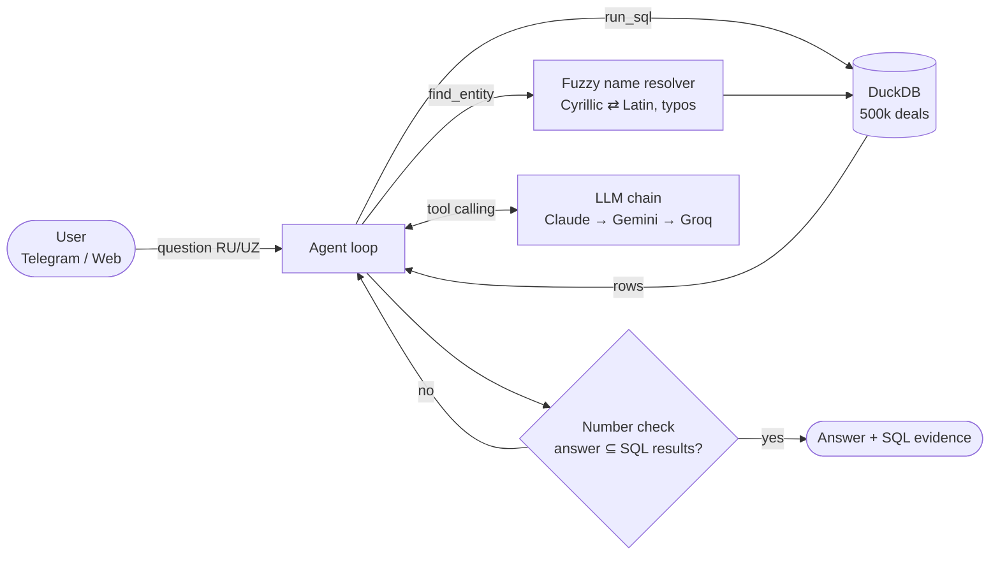

<p align="center">
  
</p>

<h1 align="center">UZEX AI-agent</h1>

<p align="center">
  An AI agent that answers questions about the UZEX commodity-exchange deals registry —<br>
  in <b>Uzbek</b> (Latin &amp; Cyrillic) and <b>Russian</b>, <b>strictly from the data</b>, with the evidence shown under every answer.
</p>

<p align="center">
  <a href="https://t.me/XG_tech_bot"><b>Telegram bot</b></a> ·
  <a href="https://uzex-ai-agent.onrender.com"><b>Web chat</b></a> ·
  <a href="SOLUTION.md">Solution description (UZ)</a> ·
  <a href="tests/RESULTS.md">Test report</a>
</p>

---

## Highlights

| | |
|---|---|
| **Grounded answers** | Every number, company, INN, code and date comes from a SQL query over the registry — never from the model's memory. |
| **Honest "no data"** | If the registry has no answer (other years, products, phone numbers, …) the agent says so explicitly instead of guessing. |
| **Automatic number check** | Each number in the final answer is matched against the query results; unverified numbers are sent back to the model before the user sees anything. |
| **Transparent** | Under every answer: the SQL queries it is based on, row counts and response time. |
| **Bilingual** | Understands RU / UZ-Latin / UZ-Cyrillic, answers in the language and script of the question. Matches names across scripts (`"ҲАРАЙЎМ КИМЁ" МЧЖ` ⇄ `Harayom Kimyo`). |
| **Fast & always on** | Typical answer in 3–20 s (hard limit 80 s); the whole registry is a 38 MB embedded DuckDB file; keep-alive pings on free hosting. |
| **Resilient** | Automatic fallback across LLM providers and keys: Claude → Gemini (several keys / models) → Groq. |
| **No install, no sign-up** | Telegram bot with menu buttons and one-tap example questions, plus a web chat. |

## How it works



1. **Data layer.** `build_db.py` loads the five `deals_*.csv` files, contracts, participants, brokers and USD rates into one DuckDB file (~6 s). Numbers like `304 547 938.4` and dates `ДД.ММ.ГГГГ` are typed properly, and the formulas from the dataset README are pre-computed: volume = quantity × lot, unit price, contract currency, amount in UZS at the deal-date rate, amount in USD, seller/buyer/broker names.
2. **Entity resolution.** Company, broker and product names are transliterated and normalized (`"ҚОПУР БРОКЕР" МЧЖ` → `qopur broker`). The `find_entity` tool does Jaro-Winkler fuzzy search and returns INN / broker code / TN VED code with deal counts. Product spelling variants (`Хлопок сырец` / `Хлопок-сырец` / `ХЛОПОК-СЫРЕЦ`) are grouped.
3. **Agent.** The LLM plans the query, calls `find_entity` and `run_sql` (read-only, single SELECT, 20 s timeout, ≤ 50 rows), inspects the result and writes a short answer: the direct figure first, then 1–3 lines on how it was computed (period, filters, variants included).
4. **Guards.** (a) An answer without at least one successful query is rejected. (b) Every number in the answer is matched against tool outputs (rounding, %, kg ↔ t allowed); mismatches go back to the model. (c) Domain rules in the prompt: never sum mixed currencies or units, report cancelled deals separately, use the right table for contracts vs. deals, copy names exactly.

## Tech stack

| Layer | Technology |
|---|---|
| Data | DuckDB (embedded, read-only), Python ETL |
| Agent | OpenAI-compatible tool calling, custom loop with guards |
| LLMs | Claude Sonnet 5.5 (primary) → Gemini 3.5 Flash / 3 Flash / Flash-Lite (multiple keys) → Groq gpt-oss-120b |
| Bot | python-telegram-bot 21 (webhook), menu keyboard, inline example buttons |
| Web | FastAPI + Uvicorn, single-page chat |
| Memory & logs | PostgreSQL (Supabase), schema `uzex`; RAM fallback |
| Hosting | Render (free web service) + self-ping + UptimeRobot |

## Project structure

```
app/
  agent.py      agent loop, system prompt, number-grounding check
  llm.py        provider chain (Claude → Gemini → Groq), cooldowns, failover
  db.py         read-only SQL tool + fuzzy entity search
  textnorm.py   Cyrillic/Latin transliteration & normalization
  tg.py         Telegram UI: texts (UZ/RU), menu, example buttons, handlers
  server.py     FastAPI app: web chat, /api/ask, Telegram webhook, keep-alive
  store.py      chat memory + Q&A log (Postgres / RAM)
  web.py        web chat page
  cli.py        command-line testing
build_db.py     CSV → data/uzex.duckdb
data/           the prebuilt database (38 MB)
scripts/        bot profile setup, logo/banner generator
tests/          test questions and verified results
```

## Quick start (local)

```bash
pip install -r requirements.txt
cp .env.example .env          # fill in the keys (see Configuration)
python -m app.cli "2025-yilda eng koʻp bitim tuzgan sotuvchi kim?"   # one question in the terminal
python -m app.server          # web chat on http://localhost:8000 + Telegram bot (long polling)
```

Rebuild the database from the raw CSV files:

```bash
python build_db.py uzex_spot_data data/uzex.duckdb
```

> Running the server locally switches the bot to polling and removes the production webhook. Redeploy (or restart) the server to restore it.

## Deploy (Render, free)

1. Push the repository to GitHub (`.env` is git-ignored; `data/uzex.duckdb` is committed).
2. Render → **New → Blueprint** → select the repo (`render.yaml` is used).
3. **Environment** → add the secret variables from the table below.
4. The Telegram webhook is registered automatically from `RENDER_EXTERNAL_URL`.
5. Optional: an UptimeRobot monitor on `/health` every 5 min (the app also pings itself every 10 min).
6. Bot profile (name, descriptions, commands): `python scripts/setup_bot.py`.

## Configuration

| Variable | Required | Description |
|---|---|---|
| `TELEGRAM_BOT_TOKEN` | yes | Token from @BotFather |
| `ANTHROPIC_API_KEYS` | one LLM key at least | Claude key(s), comma-separated |
| `GEMINI_API_KEYS` | | Google AI Studio keys, comma-separated; the first one is tried first |
| `GROQ_API_KEYS` | | Groq keys (last fallback) |
| `CLAUDE_MODEL` | | default `claude-sonnet-5-5` |
| `GEMINI_MODEL` | | default `gemini-3.5-flash,gemini-3-flash-preview,gemini-3.1-flash-lite,gemini-3.5-flash-lite` |
| `LLM_ORDER` | | default `claude,gemini,groq,openrouter` |
| `DATABASE_URL` | | Postgres URL for memory & logs (Supabase pooler, port 6543) |
| `PUBLIC_URL` | | Public base URL; on Render `RENDER_EXTERNAL_URL` is used automatically |
| `DUCKDB_MEMORY` | | DuckDB memory limit, default `350MB` |

## API

```http
POST /api/ask
{"question": "Какой был курс доллара 15 марта 2025 года?"}

→ {"answer": "…12 589,97 сум…", "ok": true, "seconds": 2.7,
   "provider": "claude#1:claude-sonnet-5-5",
   "queries": [{"tool": "sql", "sql": "SELECT usd_rate FROM usd_rates WHERE …", "rows": 1}]}
```

`GET /health` → service status, number of LLM providers, bot and memory backend.

## Testing

`tests/questions*.txt` contain RU/UZ questions — rankings, totals, averages, look-ups by INN / contract / deal number, brokers, export, quarters, exchange rates, statuses, and trap questions with no answer in the data. Each answer was compared with a hand-written SQL query; see **[tests/RESULTS.md](tests/RESULTS.md)**.

```bash
python -m app.cli "Сколько сделок по золоту было в 2024 году?"
```

## Data

The dataset is the hackathon's fictional registry in the spot.uzex.uz format: 500 000 deals (03.01.2022 – 30.10.2026), 6 616 contracts, 14 392 participants, 120 brokers, daily USD rates. All companies, INNs and amounts are fictional.
