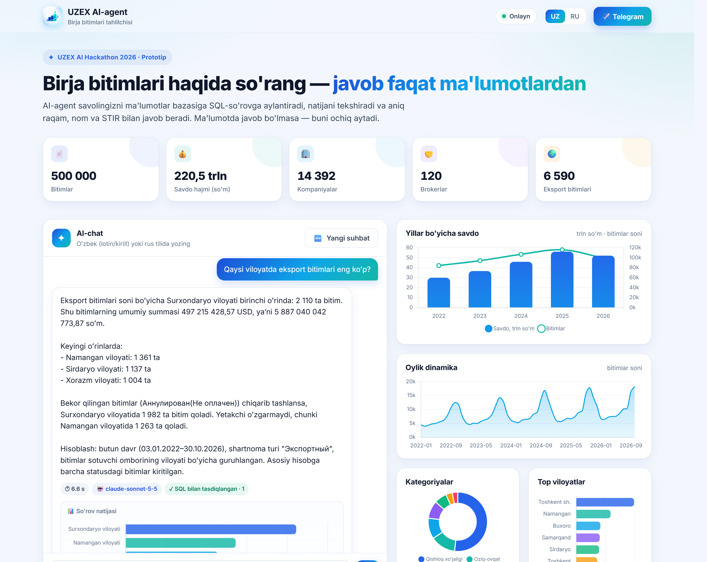
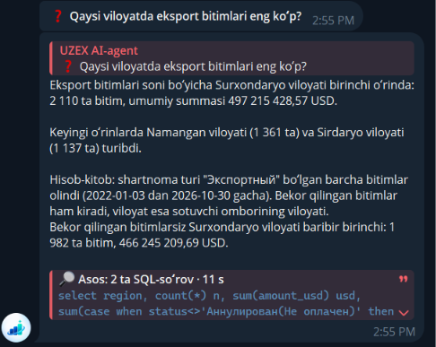
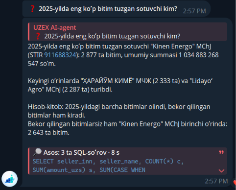
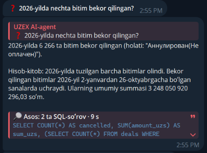

# UZEX AI-agent — yechim tavsifi

**Prototip:** Telegram-bot [@XG_tech_bot](https://t.me/XG_tech_bot) va veb-chat [uzex-ai-agent.onrender.com](https://uzex-ai-agent.onrender.com).
Oʻrnatish va roʻyxatdan oʻtish talab qilinmaydi. Savollarni oʻzbek (lotin va kirill) hamda rus tilida tushunadi va savol berilgan tilda javob beradi.

## 1. Gʻoya
Agent javobni «oʻylab» topmaydi: u savolni maʼlumotlar bazasiga SQL-soʻrovga aylantiradi, soʻrovni bajaradi va **faqat olingan natija asosida** javob yozadi. Javobdagi har bir raqam avtomatik tekshiriladi. Javobning asosi (SQL soʻrovlar) foydalanuvchiga koʻrsatiladi.

> 📄 Dizaynlangan PDF versiya: [`docs/UZEX_AI_agent_yechim.pdf`](docs/UZEX_AI_agent_yechim.pdf)

## Maʼlumotlar qanday ishlatiladi: SQL, RAG emas
- CSV fayllar bir marta **DuckDB** bazasiga yuklanadi. LLM har bir savolga **SQL-soʻrov** yozadi, baza esa yigʻindi, oʻrtacha, reyting va filtr amallarini 500 000 qator ustida **aniq** bajaradi. LLM faqat tayyor natijani matnga aylantiradi.
- **Nega RAG emas:** RAG (vektor qidiruv) bir nechta oʻxshash matn boʻlagini topadi, lekin 500 000 bitimni qoʻsha olmaydi. «2024-yildagi jami summa» yoki «eng koʻp bitim tuzgan sotuvchi» kabi savollarga aniq javob faqat SQL bilan olinadi. SQL natijasini tekshirish va foydalanuvchiga koʻrsatish ham mumkin.
- Fuzzy-qidiruv (Jaro-Winkler) faqat **nomlarni** topish uchun ishlatiladi: kompaniya, broker yoki tovar nomini STIR, broker kodi yoki TN VED kodiga bogʻlash.

## 2. Arxitektura
1. **Maʼlumotlar qatlami — DuckDB.** 5 ta `deals_*.csv`, `contracts`, `participants`, `brokers`, `usd_rates` bitta 38 MB lik bazaga yuklanadi (`build_db.py`, ~6 soniya). Raqamlar (`304 547 938.4`) va sanalar (`ДД.ММ.ГГГГ`) toʻgʻri turlarga oʻtkaziladi. README dagi formulalar oldindan hisoblanadi: hajm = miqdor × lot, birlik narxi, shartnoma valyutasi, soʻmdagi summa (USD bitimlar bitim kunidagi kurs boʻyicha), dollardagi summa, sotuvchi/xaridor/broker nomlari.
2. **Nomlarni moslashtirish.** Kompaniya, broker va tovar nomlari transliteratsiya qilinib normallashtiriladi (`"ҚОПУР БРОКЕР" МЧЖ` → `qopur broker`). `find_entity` vositasi fuzzy-qidiruv (Jaro-Winkler) bilan nomni STIR, broker kodi yoki TN VED kodiga bogʻlaydi. Bir tovarning turlicha yozilishi (`Хлопок сырец` / `Хлопок-сырец` / `ХЛОПОК-СЫРЕЦ`) birlashtiriladi. Shu sababli «Harayom Kimyo» deb lotincha yozilsa ham, bazadagi `"ҲАРАЙЎМ КИМЁ" МЧЖ` topiladi.
3. **AI-agent (tool calling).** LLM savolni tahlil qiladi, `find_entity` va `run_sql` vositalarini chaqiradi, natijani tekshiradi va qisqa javob yozadi: birinchi qatorda aniq raqam yoki nom, keyin 1–3 qatorda qanday hisoblangani (davr, filtrlar, qaysi tovar variantlari kiritilgani).
4. **LLM zanjiri (avtomatik zaxira).** Asosiy model — **Claude Sonnet 5.5**. Limit tugasa yoki xato boʻlsa, soʻrov darhol **Gemini**ga oʻtadi (avval asosiy akkaunt: 3.5 Flash → 3 Flash → Flash-Lite, keyin boshqa akkauntlar kalitlari), oxirida **Groq** (gpt-oss-120b). Foydalanuvchi buni sezmaydi.
5. **Interfeys.** Telegram-bot: menyu tugmalari (namuna savollar, bot haqida, yangi suhbat, veb-versiya), bir bosishda ishlaydigan namuna savollar, foydalanuvchi tiliga mos (UZ/RU) matnlar. Veb-chat — xuddi shu agent brauzerda.
6. **Xotira va jurnal.** Har bir chat uchun oxirgi 2 ta savol-javob eslab qolinadi (davomli savollar uchun, masalan «2025-yilda-chi?»). Barcha savollar va javoblar PostgreSQL (Supabase) bazasiga yoziladi.

## 3. Javoblar qanday tekshiriladi (gallyutsinatsiyaga qarshi)
- **Maʼlumotsiz javob yoʻq.** Agar model birorta muvaffaqiyatli SQL soʻrovsiz javob bersa, javob qabul qilinmaydi va model avval maʼlumotni tekshirishga majburlanadi.
- **Raqamlarni avtomatik tekshirish.** Javobdagi har bir raqam SQL natijalaridagi raqamlar bilan solishtiriladi (yaxlitlash, foiz, kg↔tonna hisobga olinadi). Natijada yoʻq raqam topilsa, javob foydalanuvchiga yuborilmaydi: model uni SQL bilan tasdiqlashi yoki olib tashlashi kerak.
- **«Maʼlumotda javob yoʻq».** Boshqa yil, bazada yoʻq tovar yoki maydon (masalan, telefon raqami) soʻralsa, agent buni ochiq aytadi va bazada nima borligini tushuntiradi.
- **Biznes-qoidalar.** Turli valyutadagi summalar va turli oʻlchov birligidagi hajmlar qoʻshilmaydi. Bekor qilingan bitimlar alohida koʻrsatiladi. Shartnoma haqidagi savollar shartnomalar jadvalidan olinadi. Nomlar bazadagidek aynan yoziladi.
- **Xavfsizlik.** Baza faqat oʻqish rejimida: faqat SELECT, 20 soniya timeout, 50 qator limiti.
- **Shaffoflik.** Har bir javob ostida u asoslangan SQL soʻrovlar, qaytgan qatorlar soni va javob vaqti koʻrsatiladi (Telegramda 🔎 blok, veb-chatda «Asos / Основание»).

## 4. Sinov
22 ta RU/UZ savol (lotin va kirill) qoʻlda yozilgan SQL natijalari bilan solishtirildi: reytinglar, summalar, oʻrtacha narx, STIR/shartnoma/bitim raqami boʻyicha, brokerlar, eksport, chorak, kurs, holatlar. 3 tasi maʼlumotda javobi yoʻq «tuzoq» savollar edi: 2021-yil, oltin, telefon raqami. Hammasiga toʻgʻri javob berildi. Sinov paytida topilgan 6 ta kamchilik tuzatildi: javob tili, nomlarni transliteratsiya qilish, shartnomalar sonini notoʻgʻri jadvaldan olish, tekshirilmagan daʼvo, bekor qilingan bitimlarni jimgina chiqarib tashlash, tovar variantini tushirib qoldirish. Toʻliq hisobot: `tests/RESULTS.md`.

## Tezlik
| Savol turi | Qanday ishlanadi | Vaqt |
|---|---|---|
| Salomlashish, «Sen kimsan?», «Rahmat» | Tayyor javob, bazaga ham, AI ga ham murojaat qilinmaydi | 0 s |
| Mavzudan tashqari (ob-havo, siyosat…) | SQL ishlatilmaydi; maʼlumot yoʻqligi ochiq aytiladi | ~2 s |
| Maʼlumot savoli | Odatda bitta SQL soʻrov: asosiy raqam, bekor qilinganlarsiz raqam va top-3 bir yoʻla hisoblanadi | 3–8 s |
| Takroriy savol / namuna tugmasi | Kesh (maʼlumotlar oʻzgarmaydi), PostgreSQL da saqlanadi | 0 s |

Ichki limit 80 soniya (komissiya talabi 90 soniya).

## Skrinshotlar (Telegram)
| | | |
|---|---|---|
|  |  |  |

Skrinshotlardagi barcha raqamlar qoʻlda yozilgan SQL bilan tekshirildi.

## 5. Texnologiyalar
Python 3.11 · DuckDB · FastAPI + Uvicorn · python-telegram-bot 21 (webhook) · Claude Sonnet 5.5 / Google Gemini / Groq (OpenAI-compatible API, tool calling) · PostgreSQL (Supabase) · Render (hosting, doimiy ishlashi uchun self-ping + UptimeRobot).
